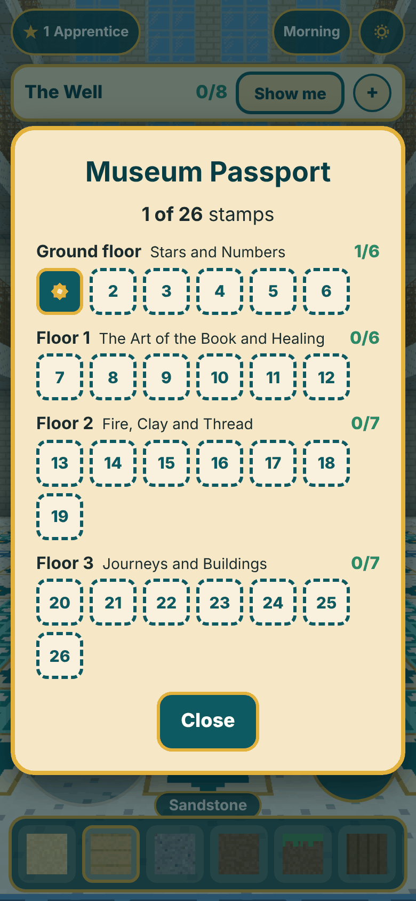

# musliMineCraft

musliMineCraft is an educational, Islamic-themed block-building game for children. It is made for phones and tablets.
The whole game is one offline HTML file. It uses raw WebGL 1 and plain JavaScript, with no libraries.

Copyright © 2026 Omar Al Zabir.

License: [CC BY-NC-SA 4.0](LICENSE) (Creative Commons Attribution-NonCommercial-ShareAlike 4.0 International). You may use, modify and share musliMineCraft for free, including for education, with credit and under the same licence. You may not use it for commercial purposes.

## Screenshots

| First view | Grand mosque | Builder friends |
|---|---|---|
|  |  |  |

| Museum | Exhibit card | Passport |
|---|---|---|
|  |  |  |

More are in `docs/screenshots/`: the museum atrium, builder close-up, swimming, tablet layout and the skyline at sunset.

## Features

- 7 maths building missions. Children fill a glowing blueprint (counting, area, volume, square numbers) and unlock new blocks.
- Quiz chests with questions and rewards.
- A streaming world of 2048 x 2048 blocks, with mosques, gardens, orchards and vineyards.
- The Museum of Islamic Heritage: 26 exhibits on four floors, and a passport that is stamped for each exhibit.
- Six builder friends. Each has a trade. They build structures and tidy up older ones.
- Build together: join a builder friend and help finish a structure.
- Swimming in lakes, with a "Swim to shore" helper.
- Signposts all over the map. One stands right next to the start and lists the main attractions (the lake, Grand Mosque, museum, Charbagh Garden and the Open Air Prison), so you see them in the first view. Walk up to any other and it lists the three nearest places (mosques, the museum, gardens, the lake, the Open Air Prison, ...) with distances and arrows that turn with your view.
- Stargate portals: three gates stand around the start (to the Museum of Islamic Heritage, the Grand Mosque and the Open Air Prison), and each place has a gate back. Walk into the shimmering horizon: the chevrons lock, the horizon bursts, a warp tunnel flashes past with synthesised sound, and you step out at the other gate.
- Quests: the map-pin button lists quests (Mosque Visit, Museum Visit, Save the Muslims from Drone Attacks in the Open Air Prison, Garden Walk, Lake Swim, Caravanserai Visit). Tap one to fly there. Finishing a quest the first time gives 2 stars.
- The Open Air Prison: an island east of spawn, ringed by water, where 24 people run from drone attacks. Build shelters with roofs; each roofed floor spot hides one person. After each attack you earn a point per sheltered person, and stars the first time 5, 10, 15, 20 and all 24 are safe. Reach it by swimming east, with My Skills then Open Air Prison, or with the quest "Save the Muslims from Drone Attacks in the Open Air Prison". Nobody is shown dying: a person caught in the open is knocked down and gets up.
- A command console: press `/` (or Settings then Console on a touch screen). `/help` lists the commands, `/share` opens a lobby, `/join`, `/players`, `/endstream` and `/leave` work the lobby.
- Play together without a server. The host types `/share` and sends the invite code to a friend (type it again for each extra friend: one invite brings one more player, up to eight waiting at a time). Every invite also comes as a link that ends in `#join=`, and where the browser has a share sheet the console offers a **Share** button; opening the link fills the code into the join card. Otherwise the friend presses **Join lobby** on the start screen and pastes the code — extra spaces, line breaks and the whole link are all accepted — then sends the reply code back. The host types `/join` and pastes each reply code: their browsers talk to each other directly (WebRTC), the world runs on the host's device and is saved there. The codes are short (about 200 characters for the invite, 160 for the reply) because only the few facts the two browsers have to agree on are packed into them, never the whole connection text. `/endstream` closes the lobby, the guests are told the host cancelled the game, and the host keeps playing alone.
- Several worlds. The start screen lists your worlds under the big Continue button; tap one to open it. **+ New** adds a world and every world keeps its own buildings, stars and position.
- Saving and resume. Progress and every edited chunk are stored on the device.
- Adaptive quality, so it runs on low-end Android phones.

## Quick start

The built game is committed, so you do not need to build anything. The live site is [oazabir.github.io/musliMineCraft](https://oazabir.github.io/musliMineCraft/): its front page is the marketing page in `landing/`, and **Play free** opens the game at [musliMineCraft.html](https://oazabir.github.io/musliMineCraft/musliMineCraft.html).

- Open `dist/musliMineCraft.html` in a modern browser.
- Or serve the folder and open the page:

```bash
python3 -m http.server 8000
# then open http://localhost:8000/dist/musliMineCraft.html
```

## Embedding in an app

Load `dist/musliMineCraft.html` full size (the page fills the whole view). It needs three things from the host:

- JavaScript enabled.
- DOM storage (`localStorage`) enabled. Android WebView has this off by default.
- IndexedDB allowed. The game saves edited chunks there.

Examples:

```html
<!-- iframe -->
<iframe src="musliMineCraft.html" style="position:fixed;inset:0;width:100%;height:100%;border:0"></iframe>
```

```kotlin
// Android WebView
webView.settings.javaScriptEnabled = true
webView.settings.domStorageEnabled = true   // off by default
webView.loadUrl("file:///android_asset/musliMineCraft.html")
```

```swift
// iOS WKWebView (JavaScript is on by default)
let web = WKWebView(frame: view.bounds)
web.loadFileURL(url, allowingReadAccessTo: url.deletingLastPathComponent())
```

### Save and embedding API

This is exactly what the game provides today (see `src/5c-save.js` and the comment at the top of `src/1-head.html`).

JavaScript object `window.musliMineCraft` (`window.IslamineCraft` is an old alias for the same object; `musliMineCraft.version` is `4`):

- `musliMineCraft.exportSave()` returns a Promise of a JSON string. It holds progress, all edited chunks and builder-bot edits.
- `musliMineCraft.importSave(json)` checks the JSON, replaces the save, then reloads the page. The Promise rejects on invalid input.
- `musliMineCraft.onSave = fn` sets a callback. It is called after each save with `{stars, mission, blocks, time}`.

Messages with the parent window (when the game is in an iframe):

- Game to host: `{type: 'musliMineCraft:save', stars, mission, blocks}` after each save. It is posted only to the origins in `window.musliMineCraftAllowedOrigins`, and never to `*`. If that list is not set, nothing is posted.
- Host to game: `{type: 'musliMineCraft:import', json}`. The game accepts it only when all three are true:
  1. `window.musliMineCraftAllowImport === true` in the game window.
  2. The message comes from `window.parent`.
  3. Its origin is in `window.musliMineCraftAllowedOrigins`.

  `musliMineCraftAllowedOrigins` is an array the host sets inside the game window. There is no default.

Other behaviour:

- Only one tab writes the save (a Web Lock named `musliMineCraft-writer`). A second tab shows "musliMineCraft is open in another tab" and a "Play here" button.
- Storage: IndexedDB database `musliMineCraft` (store `c` = edited chunks, `m` = builder edits, `w` = the worlds that are not open); `localStorage` keys `musliMineCraft_prog_v1` (progress), `musliMineCraft_jrn_v1` (journal of unconfirmed chunk writes), `musliMineCraft_save_v1` (fallback, used only if IndexedDB is not available), `musliMineCraft_worlds_v1` (the worlds list) and `musliMineCraft_active_v1` (the open world).
- A save from the older IslamineCraft build (`islaminecraft_save_v1`) is migrated once on first start.

## Museum photo credits

15 of the 26 museum exhibits can show a real photo over their drawing. The list is the constant `EXHIBIT_PHOTOS` at the top of `src/5b-museum-ui.js`. Each record has a `url`, a `page` and a `credit`.

- The photos are hot-linked from the Metropolitan Museum of Art, the Wellcome Collection and the Rijksmuseum. These sites do not promise that hot-linking will keep working.
- For production, download the 15 images, put them on your own CDN, and change the `url` values in that one table.
- The game loads a photo only while its exhibit card is open, and shows the credit line with it. If the load fails, times out or the device is offline, the drawing stays and nothing is shown.
- These are the only network requests the game makes besides the multiplayer lobby: a WebRTC peer connection between the host and each guest, and one public STUN server (`NET_STUN` in `src/5h-net.js`) used to look up network addresses. There is no game server and nothing is uploaded anywhere. A lobby between two different networks needs that STUN lookup; on one local network the browsers find each other without it.
- The Claude artifact preview blocks remote images, so only the drawings show there.

## Building

The game is built from the parts in `src/`. Run this from the repo root:

```bash
./build.sh
```

It joins the parts in a fixed order and writes `dist/musliMineCraft.html`. It needs only bash and awk. Blank lines and full-line comments in the JS parts are dropped. Commit the new `dist/musliMineCraft.html` with your source changes. CI fails if it is out of date.

## Running the tests

The tests are Playwright end-to-end tests that drive the real game in headless Chromium (software WebGL, no GPU needed).

```bash
pip install -r tests/e2e/requirements.txt
python -m playwright install --with-deps chromium
cd tests/e2e
pytest
```

Environment variables:

- `GAME_URL`: page to test. Default is `dist/musliMineCraft.html` in this repo.
- `HEADED=1`: show the browser window.
- `SLOW=1`: make every wait three times longer, for slow machines.

The full suite takes about 15 to 20 minutes. Run one group with `pytest -k Bots`. More detail is in `tests/e2e/README.md`.

## Project structure

```
src/                  game source parts (HTML head, JS modules, HTML tail)
build.sh              joins src/ into dist/musliMineCraft.html
dist/musliMineCraft.html    the built, self-contained game (committed)
landing/              the marketing front page served at the site root
tests/e2e/            Playwright tests, pytest.ini, requirements, test README
docs/screenshots/     screenshots used in this README
.github/workflows/    GitHub Actions: build check, e2e tests and the Pages deploy
```

## Known limitations

- Tested in headless Chromium with SwiftShader (software WebGL) only. It has not yet been tested on real low-end Android hardware.
- The lobby has no server, so the two codes have to be carried by hand (a chat message, a note, a QR reader): the invite code goes to the guest, the reply code comes back to the host. A lobby across two different networks also needs the public STUN server to be reachable. Both players need the same version of the game, because a code only describes the browser that made it.
- In a lobby the host is the real world: guests can move, build and see each other, but missions, builders and the Open Air Prison stay on the host's device. A guest goes back to its own world when the host ends the stream. Other players are drawn between packets, so they walk smoothly instead of jumping about.
- Museum photos are hot-linked and may fail to load. The drawings always work.
- The Claude artifact preview blocks remote images, so photos do not show there.
- Real GPU performance, audio output and pixel-level rendering are not covered by the tests.

## Content notes

- The game does not generate any Quran or hadith text.
- Facts in the museum, quiz and missions should be reviewed by a qualified person before release.
