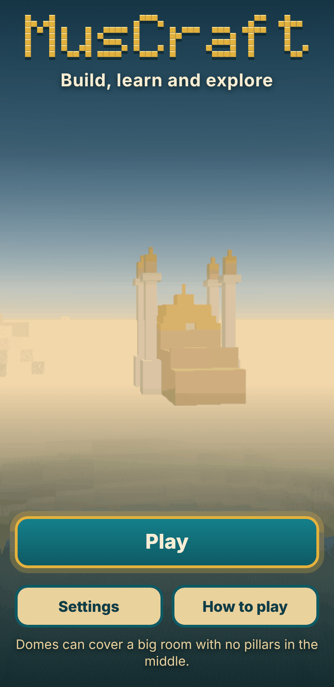
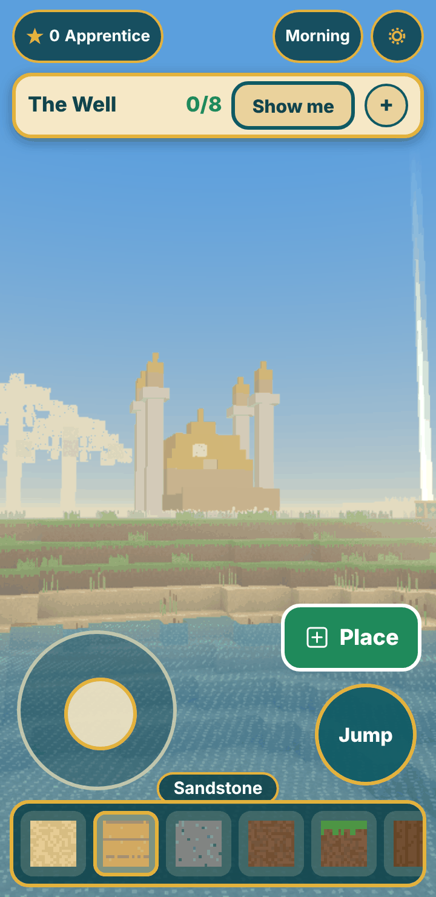
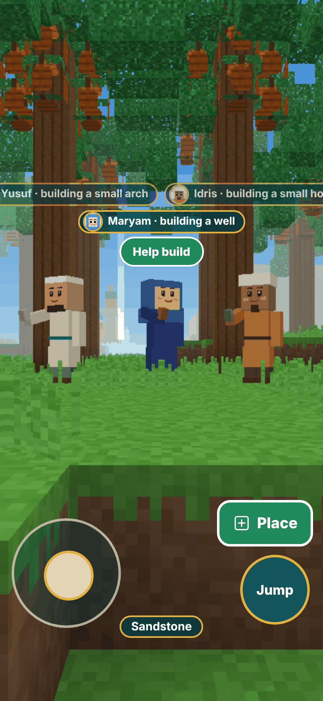
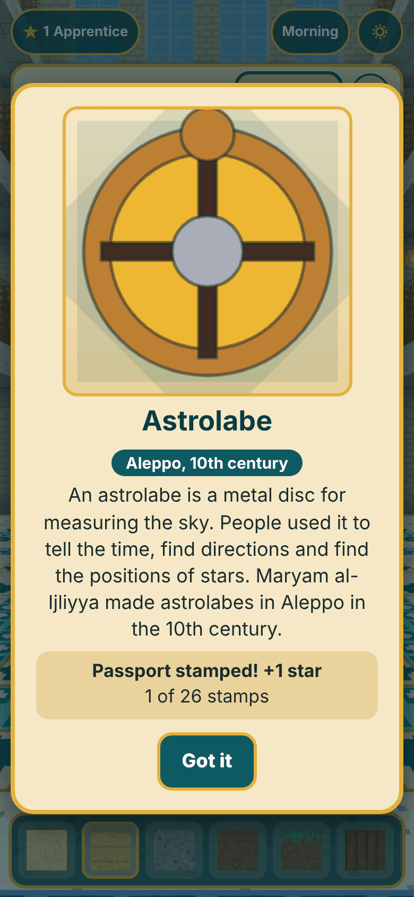

# MusCraft

MusCraft is an educational, Islamic-themed block-building game for children. It is made for phones and tablets.
The whole game is one offline HTML file. It uses raw WebGL 1 and plain JavaScript, with no libraries.

License: not yet chosen — all rights reserved until a licence is added.



## Features

- 7 maths building missions. Children fill a glowing blueprint (counting, area, volume, square numbers) and unlock new blocks.
- Quiz chests with questions and rewards.
- A streaming world of 2048 x 2048 blocks, with mosques, gardens, orchards and vineyards.
- The Museum of Islamic Heritage: 26 exhibits on four floors, and a passport that is stamped for each exhibit.
- Six builder friends. Each has a trade. They build structures and tidy up older ones.
- Build together: join a builder friend and help finish a structure.
- Swimming in lakes, with a "Swim to shore" helper.
- Saving and resume. Progress and every edited chunk are stored on the device.
- Adaptive quality, so it runs on low-end Android phones.

## Screenshots

| First view | Grand mosque | Builder friends |
|---|---|---|
|  |  |  |

| Museum | Exhibit card | Passport |
|---|---|---|
|  |  |  |

More are in `docs/screenshots/`: the museum atrium, builder close-up, swimming, tablet layout and the skyline at sunset.

## Quick start

The built game is committed, so you do not need to build anything.

- Open `dist/muscraft.html` in a modern browser.
- Or serve the folder and open the page:

```bash
python3 -m http.server 8000
# then open http://localhost:8000/dist/muscraft.html
```

## Embedding in an app

Load `dist/muscraft.html` full size (the page fills the whole view). It needs three things from the host:

- JavaScript enabled.
- DOM storage (`localStorage`) enabled. Android WebView has this off by default.
- IndexedDB allowed. The game saves edited chunks there.

Examples:

```html
<!-- iframe -->
<iframe src="muscraft.html" style="position:fixed;inset:0;width:100%;height:100%;border:0"></iframe>
```

```kotlin
// Android WebView
webView.settings.javaScriptEnabled = true
webView.settings.domStorageEnabled = true   // off by default
webView.loadUrl("file:///android_asset/muscraft.html")
```

```swift
// iOS WKWebView (JavaScript is on by default)
let web = WKWebView(frame: view.bounds)
web.loadFileURL(url, allowingReadAccessTo: url.deletingLastPathComponent())
```

### Save and embedding API

This is exactly what the game provides today (see `src/5c-save.js` and the comment at the top of `src/1-head.html`).

JavaScript object `window.MusCraft` (`window.IslamineCraft` is an old alias for the same object; `MusCraft.version` is `4`):

- `MusCraft.exportSave()` returns a Promise of a JSON string. It holds progress, all edited chunks and builder-bot edits.
- `MusCraft.importSave(json)` checks the JSON, replaces the save, then reloads the page. The Promise rejects on invalid input.
- `MusCraft.onSave = fn` sets a callback. It is called after each save with `{stars, mission, blocks, time}`.

Messages with the parent window (when the game is in an iframe):

- Game to host: `{type: 'muscraft:save', stars, mission, blocks}` after each save. It is posted only to the origins in `window.MusCraftAllowedOrigins`, and never to `*`. If that list is not set, nothing is posted.
- Host to game: `{type: 'muscraft:import', json}`. The game accepts it only when all three are true:
  1. `window.MusCraftAllowImport === true` in the game window.
  2. The message comes from `window.parent`.
  3. Its origin is in `window.MusCraftAllowedOrigins`.

  `MusCraftAllowedOrigins` is an array the host sets inside the game window. There is no default.

Other behaviour:

- Only one tab writes the save (a Web Lock named `muscraft-writer`). A second tab shows "MusCraft is open in another tab" and a "Play here" button.
- Storage: IndexedDB database `muscraft`; `localStorage` keys `muscraft_prog_v1` (progress), `muscraft_jrn_v1` (journal of unconfirmed chunk writes) and `muscraft_save_v1` (fallback, used only if IndexedDB is not available).
- A save from the older IslamineCraft build (`islaminecraft_save_v1`) is migrated once on first start.

## Museum photo credits

15 of the 26 museum exhibits can show a real photo over their drawing. The list is the constant `EXHIBIT_PHOTOS` at the top of `src/5b-museum-ui.js`. Each record has a `url`, a `page` and a `credit`.

- The photos are hot-linked from the Metropolitan Museum of Art, the Wellcome Collection and the Rijksmuseum. These sites do not promise that hot-linking will keep working.
- For production, download the 15 images, put them on your own CDN, and change the `url` values in that one table.
- The game loads a photo only while its exhibit card is open, and shows the credit line with it. If the load fails, times out or the device is offline, the drawing stays and nothing is shown.
- These are the only network requests the game can make.
- The Claude artifact preview blocks remote images, so only the drawings show there.

## Building

The game is built from the parts in `src/`. Run this from the repo root:

```bash
./build.sh
```

It joins the parts in a fixed order and writes `dist/muscraft.html`. It needs only bash and awk. Blank lines and full-line comments in the JS parts are dropped. Commit the new `dist/muscraft.html` with your source changes. CI fails if it is out of date.

## Running the tests

The tests are Playwright end-to-end tests that drive the real game in headless Chromium (software WebGL, no GPU needed).

```bash
pip install -r tests/e2e/requirements.txt
python -m playwright install --with-deps chromium
cd tests/e2e
pytest
```

Environment variables:

- `GAME_URL`: page to test. Default is `dist/muscraft.html` in this repo.
- `HEADED=1`: show the browser window.
- `SLOW=1`: make every wait three times longer, for slow machines.

The full suite takes about 15 to 20 minutes. Run one group with `pytest -k Bots`. More detail is in `tests/e2e/README.md`.

## Project structure

```
src/                  game source parts (HTML head, JS modules, HTML tail)
build.sh              joins src/ into dist/muscraft.html
dist/muscraft.html    the built, self-contained game (committed)
tests/e2e/            Playwright tests, pytest.ini, requirements, test README
docs/screenshots/     screenshots used in this README
.github/workflows/    GitHub Actions: build check and e2e tests
```

## Known limitations

- Tested in headless Chromium with SwiftShader (software WebGL) only. It has not yet been tested on real low-end Android hardware.
- Museum photos are hot-linked and may fail to load. The drawings always work.
- The Claude artifact preview blocks remote images, so photos do not show there.
- Real GPU performance, audio output and pixel-level rendering are not covered by the tests.

## Content notes

- The game does not generate any Quran or hadith text.
- Facts in the museum, quiz and missions should be reviewed by a qualified person before release.
